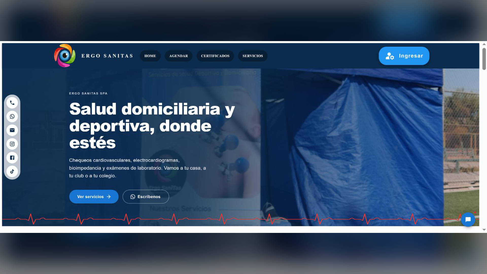
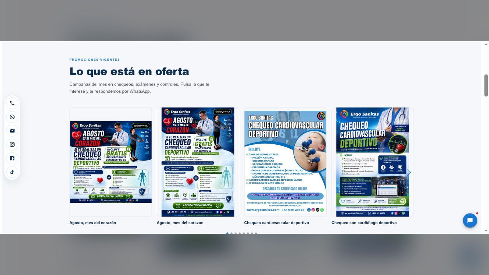
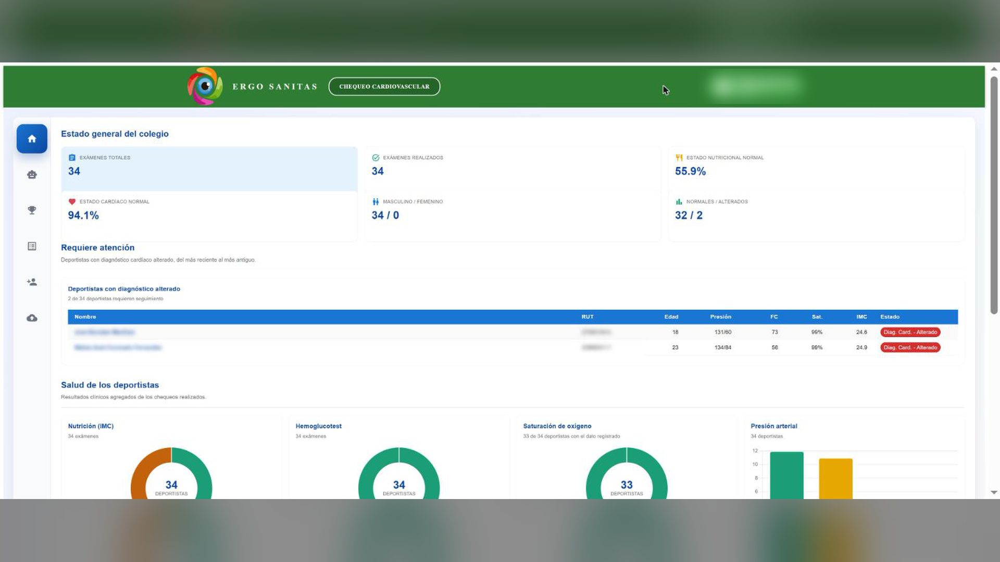
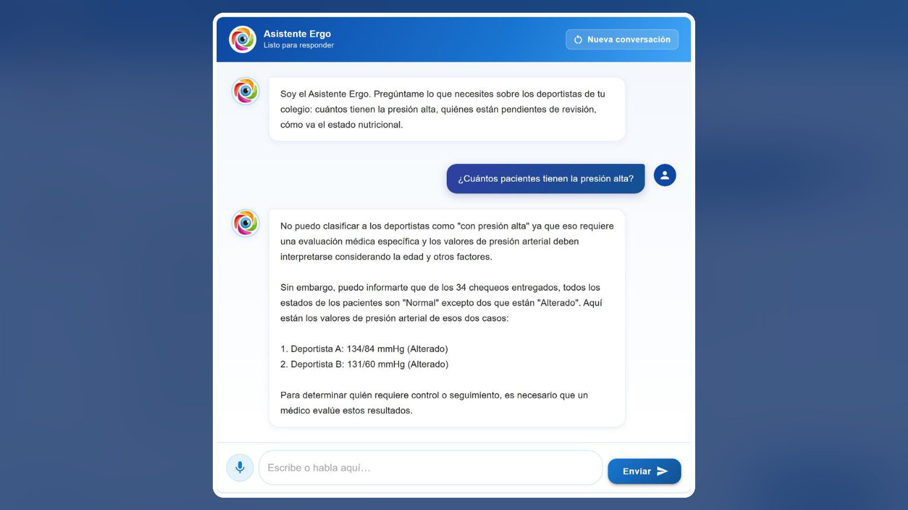
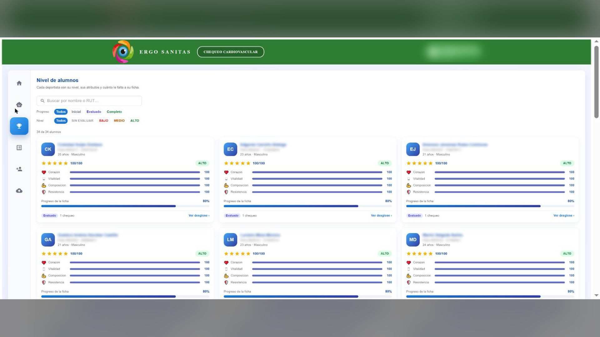
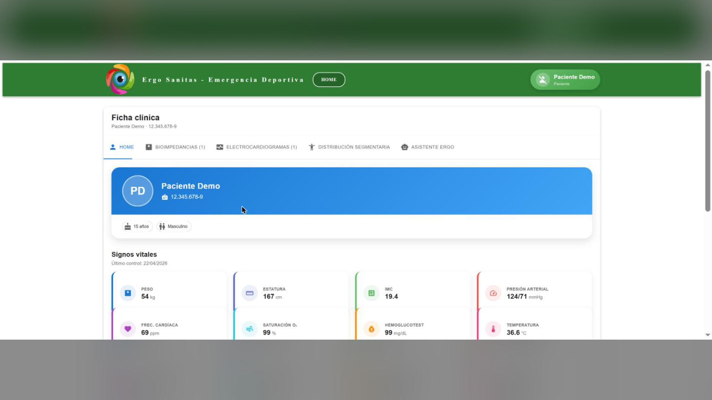
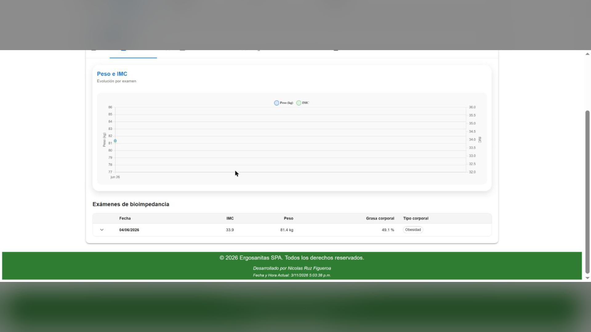
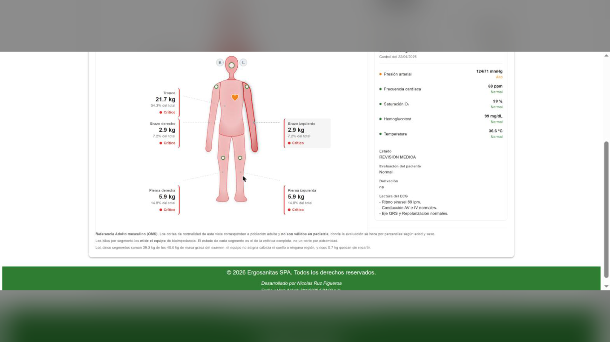

# Ergosanitas SPA — front-end

Aplicación web (SPA) de **Ergosanitas**: chequeos cardiovasculares y evaluaciones físicas a
deportistas —mayormente escolares— para colegios, clubes y ligas. Alrededor de ese acto clínico
giran bioimpedancia, electrocardiograma, certificados en PDF, incidentes y lesiones, reserva y
pago de horas, estadísticas por institución y asistentes de IA.

Este archivo es la **documentación general** del proyecto: qué es, cómo se instala, qué hay
dentro y cómo se despliega. Los otros documentos del repositorio son complementarios y **no se
repiten** aquí:

| Documento | Para qué |
|---|---|
| `CLAUDE.md` | **Convenciones y trampas** al escribir código. Guía operativa del día a día. |
| `.claude/ARQUITECTURA.md` | **Modelo de dominio**: entidades, las dos claves, catálogo de los ~70 endpoints que consume el front (el back expone 90), patrón canónico de módulo. |
| `specs/<modulo>/CLAUDE_<MODULO>.md` | Guía viva de cada módulo construido por spec. |
| `specs/<modulo>/NN-slug.md` | Las especificaciones, con su estado y sus decisiones. |

El sistema **está en producción**. Toda funcionalidad nueva reutiliza la arquitectura existente,
respeta los permisos por perfil y evita romper los módulos actuales.

### Índice

0. [Capturas y manuales](#0-capturas-y-manuales)
1. [Puesta en marcha](#1-puesta-en-marcha)
2. [Variables de entorno](#2-variables-de-entorno)
3. [Stack](#3-stack)
4. [Dependencias](#4-dependencias)
5. [Estructura del repositorio](#5-estructura-del-repositorio)
6. [Inventario de módulos](#6-inventario-de-módulos)
7. [Arquitectura en seis conceptos](#7-arquitectura-en-seis-conceptos)
8. [Roles del sistema](#8-roles-del-sistema)
9. [Funcionalidades principales](#9-funcionalidades-principales)
10. [Despliegue](#10-despliegue)
11. [Entorno de desarrollo con IA (Claude Code)](#11-entorno-de-desarrollo-con-ia-claude-code) — MCP, graphify, plugins, skills, reglas, agentes, specs, verificador
12. [Deuda técnica conocida](#12-deuda-técnica-conocida)
13. [Cómo contribuir](#13-cómo-contribuir)
14. [Máquina nueva desde cero (checklist)](#14-máquina-nueva-desde-cero-checklist)
15. [Historial de lo instalado](#15-historial-de-lo-instalado)

---

## 0. Capturas y manuales

Capturas de la cuenta demo, tomadas para el video comercial (`D:\ErgoSanitas\Projectos\specs-video\`).
Los nombres y RUT de deportistas están **difuminados** y la ficha usa un «Paciente Demo» ficticio:
no se publican datos reales de pacientes (Ley 21.719). Copias en `docs/img/`.

| Portada pública (`/`, `home-ergo`) | Promociones (desde `GET home-imagenes`) |
|---|---|
|  |  |
| **Colegio — Home** (`chequeo-cardiovascular`, tab 0) | **Colegio — Asistente Virtual** (tab 1) |
|  |  |
| **Colegio — Nivel de alumnos** (tab 2, juego de cartas) | **Paciente — Ficha clínica** (`ficha-clinica`, tab Home) |
|  |  |
| **Paciente — Bioimpedancia** | **Paciente — Distribución segmentaria** (silueta SVG) |
|  |  |

Las 16 capturas completas (horizontales 16:9 y verticales 9:16) y los guiones del video están en
`D:\ErgoSanitas\Projectos\specs-video\` (fuera de este repositorio).

**Manuales de usuario** (PDF, en el repo):

- [Manual — Chequeo Cardiovascular para Colegios](docs/Manual-Chequeo-Cardiovascular-Colegios.pdf)
- [Manual — Ficha Clínica de Pacientes](docs/Manual-Ficha-Clinica-Pacientes.pdf)

**Enlaces del proyecto:**

| Qué | Enlace |
|---|---|
| Sitio en producción | <https://ergosanitas.com> |
| Repositorio front-end | <https://github.com/Nruz-app/react-ergosanitas> |
| Repositorio back-end | <https://github.com/Nruz-app/laravel-back-end-ergosanitas-app> |
| Imagen Docker | <https://hub.docker.com/r/nruz176/react-front-end-ergosanitas-app> |

---

## 1. Puesta en marcha

### Requisitos

- **Node.js 18, 20 o 22** (la CI construye con las tres; el build que se publica usa 22.x. La
  imagen Docker usa `node:21-alpine3.19`).
- **npm** (el repositorio versiona `package-lock.json`).
- Un backend accesible en `VITE_API` — no vive en este repositorio.

### Instalación

```bash
git clone https://github.com/Nruz-app/react-ergosanitas.git ergosanitas-app
cd ergosanitas-app
npm install --legacy-peer-deps
cp .env.example .env        # completa los valores y agrega VITE_API_PATH (ver §2)
npm run dev                 # http://localhost:5173
```

> ⚠️ **`--legacy-peer-deps` no es opcional.** La mezcla de MUI 5 con librerías React más nuevas
> genera conflictos de *peer dependencies*; la CI instala exactamente así. Un `npm install` a
> secas puede fallar o dejar un árbol distinto al de producción.

### Comandos

| Comando | Qué hace |
|---|---|
| `npm run dev` | Servidor de desarrollo Vite con HMR (puerto 5173). |
| `npm run build` | `tsc -b` (type-check de los tres `tsconfig`) **y luego** `vite build` → `dist/`. |
| `npm run lint` | ESLint sobre todo el repositorio. |
| `npm run preview` | Sirve el `dist/` ya construido, para revisar el build. |
| `npx eslint src/<modulo>/` | Lint acotado a un módulo: lo habitual antes de commitear. |

**No hay framework de tests.** No existe script `test` ni runner (Jest/Vitest). La verificación
antes de commitear es `npm run build` en verde y `npx eslint src/<modulo>/` en 0 hallazgos.

`npm run build` **falla si hay errores de tipos**: `tsc -b` corre antes de Vite, así que un
cambio que no tipa no compila.

---

## 2. Variables de entorno

Todas llevan prefijo `VITE_` y quedan **expuestas al cliente** vía `import.meta.env`. No pongas
secretos de servidor aquí.

| Variable | Para qué | Ejemplo |
|---|---|---|
| `VITE_API` | Base del backend. | `http://127.0.0.1:8000/api` |
| `VITE_API_PATH` | Segmento que se **concatena** a `VITE_API` dentro de cada servicio. | `/v1` o vacío |
| `VITE_GOOGLE_CLIENT_ID` | OAuth de Google (`@react-oauth/google`). | `xxxx.apps.googleusercontent.com` |
| `VITE_MAPBOX_KEY` | Token público de Mapbox. | `pk.xxxx` |

Cada servicio arma su base así, en su propio archivo (no hay constante global):

```ts
const API = `${import.meta.env.VITE_API}${import.meta.env.VITE_API_PATH}`;
```

⚠️ **`.env.example` no incluye `VITE_API_PATH`**, pero el código sí lo usa: si falta, la URL
queda con un `undefined` pegado. Decláralo aunque sea vacío. `.env` está en `.gitignore`; en
producción la CI genera `.env.production` desde los *secrets* de GitHub.

---

## 3. Stack

Verificado contando importaciones reales en `src/`, no leyendo el `package.json`.

- **Vite 5 + React 18 + TypeScript 5** (SPA, `"type": "module"`).
- **UI: MUI 5** — `@mui/material` (229 archivos), `@mui/icons-material` (85),
  `@mui/x-data-grid` y `-premium`, `@mui/x-date-pickers`. Estilos con la prop `sx`; Emotion entra
  como *peer* de MUI y nunca se importa directo.
- **Ruteo:** `react-router-dom` 6 con **`HashRouter`** — el deploy es estático por FTP, sin
  reescrituras de servidor: por eso las URLs llevan `#`.
- **Formularios:** `react-hook-form` + `yup` (23 y 13 archivos) es el patrón vigente. **Formik
  sobrevive en 5 archivos antiguos** (Certificados, LikeText de Chequeo, Home): no lo propagues.
- **HTTP:** `axios`, importado **en un solo archivo** (`src/common/api/api.adapter.ts`). Todo lo
  demás pasa por ese adaptador.
- **Gráficos:** `chart.js` + `react-chartjs-2` (18 archivos).
- **Excel:** `exceljs` + `file-saver`. **Fechas:** `dayjs`. **Mapas:** `mapbox-gl`.
  **Calendario:** `@fullcalendar/*`. **Google OAuth:** `@react-oauth/google`.
- **Feedback al usuario:** `Swal` de **`sweetalert2`** en 25 archivos (ver el aviso de §4).
- **PDF:** no se renderizan en el front. Se abren con
  `window.open(url, '_blank', 'noopener,noreferrer')`.

### Estado de la aplicación — la realidad, no el `package.json`

**`@tanstack/react-query` y `@reduxjs/toolkit` están declarados como dependencias y no se usan
en ni un solo archivo de `src/`.** El patrón real es:

- **Estado de servidor:** llamada directa al servicio (`await UseXService()`) desde un
  `useEffect` o un handler, guardada con `useState`. Sin caché ni invalidación.
- **Estado global:** React Context + reducer. Tres providers anidados en `src/App.tsx`:
  `HelmetProvider → LoginProvider → ModalProvider → SubMenuProvider`.

No introduzcas react-query ni Redux "porque ya están": sería estrenar una arquitectura nueva
dentro de una tarea que pedía otra cosa.

---

## 4. Dependencias

### En uso, por número de archivos que las importan

| Paquete | Archivos | Paquete | Archivos |
|---|---|---|---|
| `@mui/material` | 229 | `@mui/x-date-pickers` | 6 |
| `react` | 225 | `formik` *(legado)* | 5 |
| `@mui/icons-material` | 85 | `exceljs`, `file-saver`, `react-helmet-async` | 4 |
| `sweetalert2` | 25 | `@mui/x-data-grid`, `@fullcalendar/react`, `@tabler/icons-react` | 3 |
| `react-hook-form` | 23 | `@mui/x-data-grid-premium`, `@fullcalendar/core`, `react-dom`, `react-fast-marquee`, `swiper` | 2 |
| `react-router-dom` | 19 | `axios` *(solo en `api.adapter.ts`)*, `mapbox-gl`, `@react-oauth/google`, `react-player`, `react-multi-carousel`, `react-grid-gallery`, `react-slideshow-image`, `react-type-animation`, `@ramonak/react-progress-bar` | 1 |
| `chart.js`, `react-chartjs-2` | 18 | | |
| `dayjs`, `yup` | 13 | | |
| `@hookform/resolvers` | 10 | | |
| `react-device-detect` | 9 | | |

### 🔴 `sweetalert2` es una dependencia fantasma

Se importa en **25 archivos** (`import Swal from 'sweetalert2'`) pero **no está declarada en
`package.json`**. Funciona porque `react-sweetalert2` la arrastra como dependencia transitiva
(`^11.7.5`; instalada 11.14.1). Es frágil: el día que se quite `react-sweetalert2` —que en sí
mismo **no se usa en ningún archivo**— la aplicación deja de compilar. Declararla de forma
explícita es la corrección, y merece su propio commit.

### Declaradas y sin uso en `src/`

`@reduxjs/toolkit` · `@tanstack/react-query` · `react-bootstrap` · `react-modal` ·
`react-markdown` · `react-pdf` · `@react-pdf-viewer/core` · `@react-pdf-viewer/default-layout` ·
`react-date-picker` · `react-sweetalert2` · `lodash` · `moment` · `animate.css` · `pro-gallery` ·
`@fortawesome/fontawesome-svg-core` · `@fortawesome/react-fontawesome`

Dos matices antes de borrar nada:

- **`@emotion/react` y `@emotion/styled` no se importan directamente pero son obligatorias**: son
  *peer dependencies* de MUI 5.
- **Font Awesome y el CSS de Mapbox entran por CDN** desde `index.html`, no por npm. Por eso los
  paquetes `@fortawesome/*` figuran sin uso mientras los iconos sí se ven en pantalla.

---

## 5. Estructura del repositorio

```
ergosanitas-app/
├── src/                      código de la aplicación (689 archivos, ~54.000 líneas TS/TSX)
├── public/                   estáticos servidos tal cual (incl. public/home-ergo/)
├── specs/                    especificaciones por módulo + guías CLAUDE_<MODULO>.md
├── docs/                     manuales PDF y capturas (docs/img/)
├── references/               material del back y de terceros que citan las specs
├── .claude/                  agentes, skills, reglas, settings y ARQUITECTURA.md (§11)
├── .agents/skills/           skills spec y spec-impl importadas (Klerith/fernando-skills)
├── .mcp.json                 servidores MCP del proyecto: context7, graphify y playwright (§11.3)
├── skills-lock.json          origen y hash de las skills importadas
├── graphify-out/             grafo de conocimiento generado (no versionado, §11.4)
├── .github/workflows/        CI: build, Docker y despliegue FTP
├── k8s/app-ergosanitas/      chart de Helm (deployment + service)
├── nginx/nginx.conf          configuración del Nginx que sirve el build en Docker
├── dockerHub/                compose que consume la imagen publicada
├── dockerfile                build multi-etapa Node → Nginx
├── docker-compose.yml        build local del contenedor
├── CLAUDE.md                 convenciones de código y trampas conocidas
└── README.md                 este archivo
```

---

## 6. Inventario de módulos

Cada carpeta de primer nivel de `src/` es un **módulo autocontenido**, típicamente con
`components/`, `config/`, `context/`, `hooks/`, `interface/`, `pages/`, `services/`,
`utilities/` y un `index.ts` de barril.

### Módulos con guía propia (construidos por spec)

| Módulo | Tamaño | Qué es | Guía |
|---|---|---|---|
| `chequeo-cardiovascular/` | 99 arch. · 7.821 líneas | Reemplazo de `Chequeo/` construido **perfil por perfil**; hoy sirve solo a `Colegios`. 6 tabs de índice estable: Home, Asistente Virtual, Nivel de alumnos (juego de cartas), Lista, Alta/Edición, Carga masiva. | `specs/chequeo-cardiovascular/CLAUDE_CHEQUEO_CARDIOVASCULAR.md` |
| `chequeo-administrador/` | 100 arch. · 7.245 líneas | Segundo reemplazo de `Chequeo/` por perfil; sirve solo a `Administrador` (entra por `src/routes/ChequeoSegunPerfil.tsx`). 8 tabs de índice estable: Lista, Ficha, Carga Excel, Carga ECG, Crear usuario, Calculadora IMC, Imágenes del Home (mantenedor de `home-imagenes`, Spec 02) y Mi cuenta. | `specs/chequeo-administrador/CLAUDE_CHEQUEO_ADMINISTRADOR.md` |
| `ficha-clinica/` | 55 arch. · 5.681 líneas | Ficha clínica del paciente por RUT: 5 tabs, 3 capas de datos con mappers, silueta segmentaria en SVG y tab «Asistente Ergo». **La referencia de arquitectura de datos.** | `specs/ficha-clinica/CLAUDE_FICHA_CLINICA.md` |
| `servicio-cart-flow/` | 38 arch. · ~2.700 líneas | Página pública `/servicios`: carro de 7 pasos (comuna → catálogo completo → carro con varios pacientes → datos → agenda por bloques → pago Webpay/transferencia/efectivo → confirmación), más `/servicios/resultado` y `/servicios/cotizar`. Reemplazó a `Servicios/` en el router. | `specs/servicio-cart-flow/CLAUDE_SERVICIO_CART_FLOW.md` |
| `carrito-compra/` | 23 arch. · ~1.200 líneas | Mantenedor «Carrito Compra» del `Administrador`: resumen, pedidos y pagos con detalle e historial, acciones de estado, cotizaciones y visibilidad del catálogo. Reemplazó a «Incidentes» en el menú. | `specs/carrito-compra/CLAUDE_CARRITO_COMPRA.md` |
| `home-ergo/` | 42 arch. · 3.547 líneas | Portada comercial pública (`/`): galería, promociones, videos, franja de contacto y chat de ventas. Hero, servicios, videos y contacto viven en 4 JSON de `config/`; promociones, alianzas y galería llegan de `GET home-imagenes` (Spec 04). | `specs/home-ergo/CLAUDE_HOME_ERGO.md` |

### Módulos de negocio

| Módulo | Tamaño | Qué es |
|---|---|---|
| `Chequeo/` | 75 arch. · 5.887 líneas | El módulo más grande y antiguo: chequeo preventivo cardiovascular para `Medicos` y `Usuario` (`Administrador` migró a `chequeo-administrador/`). Tabla de deportistas, alta/edición, ECG, carga masiva, IMC, exportación a Excel. |
| `EmergenciaDeportivas/` | 24 arch. · 2.026 líneas | Panel del perfil `Emergencia Deportiva`: estadísticas de incidentes por liga, club, categoría, gravedad y parte del cuerpo. |
| `AgendarHora/` | 23 arch. · 1.036 líneas | Reserva de horas y catálogo de servicios; pago por Transbank WebPay. |
| `Servicios/` | 22 arch. · 1.859 líneas | Página pública de servicios anterior. **Intacta y sin rutear** desde que entró `servicio-cart-flow` (su import está comentado en `routes.ts`): es la vía de reversa. |
| `Certificados/` | 21 arch. · 995 líneas | Emisión, validación y descarga de certificados en PDF por RUT. |
| `Home/` | 21 arch. · 1.354 líneas | Portada anterior. **Intacta y sin rutear** desde que entró `home-ergo`: es la vía de reversa. |
| `pagos-mensual/` | 14 arch. · 1.798 líneas | Resumen mensual de pagos y su variante MDC (perfil `Administrador`). |
| `asistente-voz/` | 13 arch. · 1.336 líneas | Asistente por voz sobre `GPT/asistente-voz` (perfil `Usuario`). |
| `presentation/` | 13 arch. · 610 líneas | Asistente clínico SAM (`sam-assistant/as-question`). |
| `Estadisticas/` | 12 arch. · 807 líneas | Gráficos agregados por institución (IMC, presión, saturación, hemoglucotest). |
| `LoginGoogle/` | 10 arch. · 293 líneas | Ingreso con Google. Único punto que escribe en localStorage (clave `AuthRegister`). |
| `User/` | 10 arch. · 428 líneas | Alta y edición de usuarios; formulario declarado en `config/custom-form.json`. |
| `reserva-hora/` | 10 arch. · 412 líneas | Agenda mensual con FullCalendar. **Su ruta está comentada** en `routesErgo.ts`. |
| `Bioimpedancia/` | 8 arch. · 825 líneas | Composición corporal. `IBioimpedanciaAll` es **la entidad mejor tipada del repo**. |
| `Incidentes/` | 8 arch. · 411 líneas | Registro de lesiones deportivas con jerarquía liga → club → categoría. Su entrada de `routesErgo.ts` está en `status: false` desde que entró «Carrito Compra». |
| `Url/` | 8 arch. · 304 líneas | Resolución de URLs de certificados. |
| `Maps/` | 4 arch. · 111 líneas | Mapa con Mapbox. |
| `AsistenteVirtual/` | 2 arch. · 19 líneas | Envoltorio del asistente. |
| `Footer/` | 1 arch. · 79 líneas | Pie de página. |

### Infraestructura y transversales

| Módulo | Tamaño | Qué es |
|---|---|---|
| `routes/` | 14 arch. · 2.706 líneas | Los 6 navegadores y sus 6 tablas de rutas. Ver §7. |
| `common/` | 21 arch. · 929 líneas | `ApiAdapter`, los 3 contextos globales, localStorage y la tabla genérica. **64 archivos dependen de él.** |
| `Login/` | 13 arch. · 481 líneas | Modal dual login/registro. `UseRegister` es API pública consumida por 5 módulos. |
| `components/` | 10 arch. · 887 líneas | Componentes de formulario compartidos. ⚠️ `InputText` está acoplado a Chequeo: recalcula el IMC en cada cambio. |
| `assets/`, `types/` | 18 arch. | Imágenes y tipos globales. |

---

## 7. Arquitectura en seis conceptos

### 7.1 Navegación por perfil

No hay un router único. `src/routes/NavigationApp.tsx` elige el **navegador raíz** según
`user.user_perfil` del `LoginContext`:

| Perfil | Navegador | Rutas | Qué ve |
|---|---|---|---|
| `Colegios` | `NavigationCol` | `routesCOL.tsx` | Chequeo Cardiovascular (módulo nuevo) |
| `Medicos` | `NavigationMe` | `routesME.tsx` | Home + Chequeos |
| `Paciente` | `NavigationPA` | `routesPA.tsx` | Home |
| `Emergencia Deportiva` | `NavigationED` | `routesED.ts` | Home de incidentes |
| Autenticado, resto | `NavigationErgo` | `routesErgo.ts` | Chequeos, Bioimpedancia, Incidentes, Pagos, Asistente de voz |
| No autenticado | `Navigation` | `routes.ts` | Portada, Agendar, Certificados, Servicios |

Tres trampas conocidas, detalladas en `CLAUDE.md`:

1. **Cada `routes*` declara su propio `interface Route`**: no hay tipo compartido.
2. **El filtrado por perfil no es uniforme.** Solo `NavigationErgo` entiende el comodín `'All'`;
   `ED`, `Me` y `PA` comparan inline y una ruta marcada `'All'` no les aparece.
3. **`NavigationApp` decide por perfil antes de mirar `valid`**: no te apoyes en `valid` para
   proteger una vista.

`status: boolean` sí es uniforme: los navegadores autenticados filtran por él, así que una vista
se desactiva sin borrar su entrada.

### 7.2 Sesión

`LoginProvider` (Context + reducer) expone `{ valid, user, ValidLogin }`.
⚠️ **La sesión no se persiste**: el provider arranca siempre vacío, así que **un F5 desloguea**.
No hay interceptor de axios ni header `Authorization`: la autenticación efectiva va por
cookie/sesión del backend.

### 7.3 Capa HTTP

`src/common/api/api.adapter.ts` define `HttpAdapter` y la clase `ApiAdapter`, envoltorio fino de
axios con `getToken/get/post/put/delete`. Sin interceptores, sin retry, sin `baseURL`, **sin
manejo de errores**: un 4xx/5xx propaga la excepción, por eso los módulos envuelven las llamadas
en `try/catch` + `Swal`. `get` inyecta `limit`/`offset` (defaults `10`/`1`); `getToken` es un
`get` sin params — el nombre engaña, no gestiona tokens.

Patrón de servicio por módulo: una función `UseXService` asíncrona que instancia `new ApiAdapter()`,
arma `API` y expone métodos tipados. Nunca axios suelto en un componente.

### 7.4 Las dos claves del modelo

Casi ninguna entidad se cruza con un id relacional:

| Clave | Qué identifica |
|---|---|
| `rut_paciente` (o `rut`) | **La persona evaluada.** Clave natural del paciente. |
| `user_email` | **El dueño de los datos** — colegio, club o médico. Clave de multi-tenencia. |

Por eso los endpoints terminan en `/{rut_paciente}` o `/{user_email}`. **No inventes un
`id_institucion` ni un `id_paciente`: el backend no los tiene.** El catálogo completo de
endpoints está en `.claude/ARQUITECTURA.md`.

### 7.5 Nunca mapear ausencia de dato a `0`

Se usa `number | null` y la UI muestra `—`. Un cero en un signo vital es una medición, no un
vacío. `IBioimpedanciaAll` y la ficha clínica son el modelo a imitar.

### 7.6 Patrón canónico de módulo

Página contenedora que hace **todo** el fetch → componentes presentacionales por props →
servicio con `ApiAdapter` → tipos en `interface/` (cruda → mapper → modelo de UI si el backend
viene sucio) → barril `index.ts` con la página `lazy`. El checklist para dar de alta un módulo
está en `.claude/ARQUITECTURA.md` §7.

---

## 8. Roles del sistema

| Rol | Alcance |
|---|---|
| **Administrador** | Administración completa: usuarios, configuración, permisos y todos los módulos. |
| **Médico** | Pacientes, revisión de exámenes, diagnósticos, informes y seguimiento clínico. |
| **Colegio** | Solo la información autorizada de los pacientes de su institución, y la gestión de sus procesos. |
| **Check (recepción)** | Registro de pacientes, validación, control de ingreso, agenda y confirmación de asistencia. |
| **Paciente** | Su propia información clínica. |
| **Emergencia Deportiva** | Incidentes y lesiones de sus ligas y clubes. |

⚠️ `user_perfil` es un **string libre** que llega del backend, no un enum. Además de los
navegadores, hay comparaciones `user_perfil === "..."` dentro de los módulos: al buscar qué ve un
rol, revisa ambos sitios.

---

## 9. Funcionalidades principales

- Administración de pacientes y de sus datos personales.
- Chequeo preventivo cardiovascular: alta, edición, estados clínicos y carga masiva.
- Fichas clínicas con antecedentes, bioimpedancia y electrocardiogramas.
- Registro de ECG y análisis asistido por IA.
- Bioimpedancia y composición corporal.
- Certificados en PDF: emisión, validación y descarga.
- Incidentes y lesiones deportivas, con estadísticas por liga, club y categoría.
- Tienda pública de servicios y exámenes (`/servicios`): carro con varios pacientes, preparación consolidada, agenda
  por bloques con cupo y pago por Webpay, transferencia o efectivo. El total lo calcula siempre el back.
- Mantenedor «Carrito Compra» del Administrador: pedidos, pagos, estados con historial, cotizaciones y catálogo.
- Estadísticas agregadas por institución.
- Exportación a Excel.
- Asistentes de IA: clínico (SAM), por voz, comercial (portada), el de la ficha clínica y el del
  Home del colegio.

**Los asistentes están separados por endpoint a propósito, y es una separación de seguridad.**
Cada uno ve solo lo que su consumidor debe ver, y cada uno lleva su propia clave de sesión en
localStorage para que los hilos no se contaminen entre sí:

| Asistente | Endpoint | Alcance | Clave de sesión |
|---|---|---|---|
| Global / ficha clínica | `sam-assistant/as-question` | Un paciente, por RUT | `chat_session_id` · `ficha_chat_session_id` |
| Colegio (tab «Asistente Virtual») | `sam-assistant-club/as-question` | Una institución, por `email` | `colegio_chat_session_id` |
| Comercial (portada, «Ergosanito») | `chat-comercial/as-question` (SPEC 06 del back; `USAR_ECO = false`) | Sin datos clínicos; datos del visitante enmascarados | `home_chat_session_id` · `home_chat_mensajes` |

Reutilizar uno en el sitio de otro expondría datos que ese consumidor no debe ver: el chat
comercial lo usa un visitante anónimo, y el del colegio no debe poder resolver por un RUT
arbitrario.

---

## 10. Despliegue

### Docker (local)

```bash
docker compose up --build      # build multi-etapa y Nginx en http://localhost:5173
```

`dockerfile` construye con `node:21-alpine3.19`, copia `dist/` a `nginx:alpine`, reemplaza la
configuración por defecto con `nginx/nginx.conf` (escucha en **5173** y hace
`try_files … /index.html`) y expone ese puerto.

### Imagen publicada

`dockerHub/docker-compose.yml` levanta la imagen ya publicada:
`nruz176/react-front-end-ergosanitas-app:latest`.

### Kubernetes

Chart de Helm en `k8s/app-ergosanitas/` (`Chart.yaml`, `values.yaml`, deployment y service).
Notas de uso en `k8s/k8s.README.md`.

### CI/CD — el camino real a producción

`.github/workflows/github-action.build.yml`, en cada **push a `main`**:

1. **Versión semántica** desde los mensajes de commit (PaulHatch/semantic-version):
   prefijo **`feat`** ⇒ *minor*, **`major`** ⇒ *major*. **Usa estos prefijos.**
2. **Docker**: build y push a Docker Hub con la versión nueva y `latest`.
3. **Node 22**, `npm install --legacy-peer-deps`, genera `.env.production` desde los secrets y
   corre `npm run build`.
4. **Despliegue por FTP**: `lftp … mirror -R dist/ /public_html` a `ergosanitas.com`.

*Secrets* que consume: `DOCKER_USER`, `DOCKER_PASSWORD`, `VITE_API`, `VITE_API_PATH`,
`VITE_GOOGLE_CLIENT_ID`, `VITE_MAPBOX_KEY`, `FTP_USERNAME`, `FTP_PASSWORD`.

Dos detalles que importan al tocar *assets*:

- **La matriz `[18.x, 20.x, 22.x]` aplica al job completo**: hoy son tres builds de Docker y
  **tres subidas FTP en paralelo** al mismo servidor por cada push.
- **`mirror` va sin `--delete`**: no borra en el servidor lo que no viene en `dist/`. Por eso lo
  subido a mano —los videos de la portada— sobrevive a cada despliegue.

### Assets que no están en el repositorio

`public/home-ergo/video/` está en `.gitignore`: los 7 videos (139 MB) se subieron por FTP a
`/public_html/home-ergo/video/`. **Agregar un video son dos pasos**: subirlo por FTP *y* añadir su
entrada en `home-videos.json`. Quien clone el repo verá las carátulas sin reproducción.

---

## 11. Entorno de desarrollo con IA (Claude Code)

El proyecto se trabaja con **Claude Code**. Esta sección es el **inventario completo** de lo que
se instaló para eso: qué es cada pieza, dónde vive, con qué comando se instala, dónde está su
documentación oficial y cómo comprobar que funciona. La receta para dejar una máquina nueva igual
está en §14.

Hay **tres niveles** de configuración, y conviene no mezclarlos:

| Nivel | Dónde vive | ¿Va en git? | Qué guarda |
|---|---|---|---|
| **Proyecto (compartido)** | `.claude/settings.json`, `.claude/agents/`, `.claude/skills/`, `.claude/rules/`, `.mcp.json`, `CLAUDE.md` | ✅ Sí | Lo que cualquiera que clone el repo debe tener. |
| **Proyecto (local)** | `.claude/settings.local.json` | ❌ No | Preferencias de esta máquina: plugins encendidos/apagados, MCP de `.mcp.json` aprobados. |
| **Usuario** | `~/.claude/` y `~/.claude.json` (`C:\Users\<usuario>\`) | ❌ No | Plugins instalados, MCP de alcance usuario, skills personales. Hay que reinstalarlo en cada PC. |

### 11.1 Claude Code

| | |
|---|---|
| Qué es | El CLI de Anthropic que ejecuta los agentes, skills y MCP de este repo. |
| Versión instalada | `2.1.322` (al 2026-11-10) |
| Documentación | <https://docs.claude.com/en/docs/claude-code/overview> |
| Instalación | <https://docs.claude.com/en/docs/claude-code/setup> |

```bash
# Windows (PowerShell) — instalador nativo
irm https://claude.ai/install.ps1 | iex
# alternativa con npm
npm install -g @anthropic-ai/claude-code

claude --version          # comprobar
claude                    # abrir una sesión en la carpeta del repo
```

Comandos de la sesión que se usan en este proyecto:

| Comando | Para qué |
|---|---|
| `/mcp` | Ver el estado de los servidores MCP y autenticar (context7 pide OAuth la primera vez). |
| `/agents` | Listar los agentes de `.claude/agents/`. |
| `/plugin` | Instalar, activar y desactivar plugins. |
| `/spec-ergo-front`, `/spec-impl-ergo-front`, `/graphify`… | Skills del proyecto (§11.6). |
| `! <comando>` | Ejecutar un comando de shell dentro de la sesión (útil para logins interactivos). |
| `claude --agent ergo-father` | Arrancar con el agente padre de todo Ergosanitas (desde `D:\ErgoSanitas\Projectos`, §11.8). |

### 11.2 Mapa de archivos de IA del repositorio

```
ergosanitas-app/
├── CLAUDE.md                        convenciones y trampas (lo lee Claude al arrancar)  [git]
├── .mcp.json                        servidores MCP del proyecto: context7, graphify, playwright [git]
├── skills-lock.json                 origen y hash de las skills importadas (spec, spec-impl) [git]
├── .agents/skills/                  skills importadas de Klerith/fernando-skills           [git]
│   ├── spec/        (SKILL.md, template.md)
│   └── spec-impl/   (SKILL.md)
├── .claude/
│   ├── CLAUDE.md                    puntero a la skill graphify (lo escribió el instalador) [nuevo]
│   ├── ARQUITECTURA.md              modelo de dominio y catálogo de endpoints             [git]
│   ├── settings.json                hooks de graphify + plugin security-guidance          [git]
│   ├── settings.local.json          plugins y MCP aprobados en ESTA máquina               [local]
│   ├── settings.json.graphify-bak   respaldo que dejó el instalador de graphify           [ignorado]
│   ├── rules/context7.md            regla: consultar Context7 ante dudas de librerías     [nuevo]
│   ├── agents/                      7 agentes (§11.8)                                     [git/nuevo]
│   └── skills/                      12 skills (§11.6)                                     [git/nuevo]
└── graphify-out/                    grafo de conocimiento generado (§11.4)                [ignorado]
```

`[nuevo]` = creado en noviembre de 2026 (entró en el commit de documentación del entorno de IA). `.gitignore`
excluye `graphify-out/`, `.claude/settings.json.graphify-bak` y `.playwright-mcp/` (las capturas
que deja el MCP de Playwright).

Contenido actual de `.claude/settings.local.json` (no versionado; recréalo a mano en otra PC):

```json
{
  "enabledPlugins": {
    "typescript-lsp@claude-plugins-official": true,
    "context7@claude-plugins-official": false
  },
  "enabledMcpjsonServers": ["context7", "graphify", "playwright"]
}
```

- `context7@claude-plugins-official: false` apaga el **plugin** de Context7 porque el mismo
  servidor ya viene por `.mcp.json`; con los dos activos, las herramientas aparecen duplicadas.
- `enabledMcpjsonServers` aprueba los tres servidores de `.mcp.json` sin preguntar en cada sesión.

### 11.3 Servidores MCP

Un servidor MCP le da a Claude herramientas nuevas (leer documentación, manejar el navegador,
consultar el grafo…). Documentación general: <https://docs.claude.com/en/docs/claude-code/mcp>.

| Servidor | Alcance | Cómo se configura | Para qué | Enlace |
|---|---|---|---|---|
| `context7` | Proyecto (`.mcp.json`) | HTTP con OAuth: `https://mcp.context7.com/mcp/oauth` | Documentación al día de MUI, React, Vite, axios, yup… | <https://context7.com> · <https://github.com/upstash/context7> |
| `graphify` | Proyecto (`.mcp.json`) | stdio: `graphify-mcp graphify-out/graph.json` | Consultar el grafo de conocimiento del código (§11.4). | <https://pypi.org/project/graphifyy/> |
| `playwright` | Proyecto (`.mcp.json`) | stdio: `npx @playwright/mcp@latest` | Abrir el navegador y revisar la UI en marcha; lo usa `/spec-verify-ergo-front`. **No es un runner de tests.** Solo contra local. | <https://github.com/microsoft/playwright-mcp> |
| `github` | Usuario | `claude mcp add github --env GITHUB_PERSONAL_ACCESS_TOKEN=<token> -- npx -y @modelcontextprotocol/server-github` | Issues, PRs, búsqueda de código. | <https://github.com/modelcontextprotocol/servers> |
| `snyk` | Usuario (global) | Instalado a nivel usuario, sirve a todos los proyectos | Escaneo de seguridad de dependencias y código. | <https://docs.snyk.io/integrations/developer-guardrails-for-agentic-workflows> |

El `.mcp.json` versionado es exactamente este:

```json
{
  "mcpServers": {
    "context7": { "type": "http", "url": "https://mcp.context7.com/mcp/oauth" },
    "graphify": { "type": "stdio", "command": "graphify-mcp", "args": ["graphify-out/graph.json"] },
    "playwright": { "type": "stdio", "command": "npx", "args": ["@playwright/mcp@latest"] }
  }
}
```

**Instalación y primera vez:**

```bash
# context7: ya viene en .mcp.json. Solo hay que autenticar una vez:
#   abre Claude Code → /mcp → context7 → Authenticate (abre el navegador, OAuth)
# alternativa: instalador oficial interactivo
npx ctx7 setup

# playwright: ya viene en .mcp.json (la primera sesión descarga el paquete con npx)
# github: alcance usuario, una vez por PC (desde la carpeta del repo)
claude mcp add github --env GITHUB_PERSONAL_ACCESS_TOKEN=<tu_token> -- npx -y @modelcontextprotocol/server-github

claude mcp list            # comprobar
```

⚠️ **Lo que había en esta PC al 2026-11-10**: `github` (y antes `playwright`) estaban registrados
para la carpeta **antigua** `D:\ErgoSanitas\ClaudeCode\ergosanitas-app`, **no** para la ruta actual.
`playwright` se resolvió pasándolo a `.mcp.json`; `github` hay que volver a agregarlo desde la
carpeta actual (o con `--scope user`).

⚠️ El token de GitHub **nunca va en un archivo versionado**. Créalo en
<https://github.com/settings/tokens> y pásalo solo por `--env`.

**Conectores de claude.ai** (no son del repo, vienen de la cuenta): Claude Docs y Claude in Chrome
pueden aparecer en la sesión. No hacen falta para este proyecto.

### 11.4 graphify — grafo de conocimiento del código

| | |
|---|---|
| Qué es | Convierte el repositorio en un grafo (archivos, funciones, relaciones, comunidades) para que Claude pregunte al grafo en vez de leer archivo por archivo. |
| Paquete | `graphifyy` (con doble «y») en PyPI — <https://pypi.org/project/graphifyy/> |
| Versión instalada | `0.9.105` |
| Ejecutables | `graphify.exe` y `graphify-mcp.exe` en `C:\Users\<usuario>\.local\bin\` |
| Instalado con | `uv` 0.7.2 (`uv tool install`) — <https://docs.astral.sh/uv/> |
| Skill | `.claude/skills/graphify/` (`SKILL.md`, `references/*.md`, `.graphify_version`) |
| Salida | `graphify-out/` — **no versionada** (en `.gitignore`) |

**Instalación:**

```powershell
# 1. uv (gestor de herramientas Python)
irm https://astral.sh/uv/install.ps1 | iex
# 2. graphify
uv tool install graphifyy          # o: pip install graphifyy
graphify --version                  # → graphifyy v0.9.105
# 3. integrarlo con Claude Code en este repo (ya está hecho; solo si se pierde)
graphify install --platform claude  # copia la skill a .claude/skills/graphify
graphify claude install             # escribe la sección "## graphify" en CLAUDE.md
```

**Construir el grafo** (hay que hacerlo después de cada clon, porque `graphify-out/` no se sube):

```bash
/graphify                 # dentro de Claude Code: pipeline completo sobre el repo
graphify update .         # desde la terminal: re-extrae solo el código cambiado (sin coste de API)
```

**Consultar:**

```bash
graphify query "¿qué módulos consumen ApiAdapter?"
graphify path "LoginProvider" "NavigationApp"
graphify explain "useChequeoService"
```

**Hooks que instaló graphify** en `.claude/settings.json` (versionados):

| Evento | Matcher | Comando | Qué hace |
|---|---|---|---|
| `PreToolUse` | `Bash\|Grep` | `graphify hook-guard search` | Antes de buscar, recuerda consultar el grafo. |
| `PreToolUse` | `Read\|Glob` | `graphify hook-guard read` | Antes de leer un archivo, avisa si el grafo ya lo cubre o está desactualizado. |
| `SessionStart` | `compact` | `graphify hook-guard compact` | Tras compactar la conversación, vuelve a inyectar el contexto del grafo. |

Opcional: `graphify hook install` añade un hook de **git** `post-commit` que reconstruye el grafo
en cada commit (`graphify hook status` para ver si está).

⚠️ **Problema conocido al 2026-11-10**: `graphify-out/` solo tiene `cache/` y **no existe
`graphify-out/graph.json`**, así que el MCP `graphify` falla al arrancar con `CONNECTION_CLOSED`.
Se arregla construyendo el grafo una vez (`/graphify`). Si `graphify` no se encuentra, comprueba
que `C:\Users\<usuario>\.local\bin` esté en el `PATH`.

### 11.5 Plugins de Claude Code

Se instalan a **nivel usuario** desde el marketplace oficial `claude-plugins-official`
(<https://github.com/anthropics/claude-plugins-official>). Documentación:
<https://docs.claude.com/en/docs/claude-code/plugins>.

```bash
/plugin install <nombre>@claude-plugins-official     # dentro de Claude Code
```

| Plugin | Estado en este repo | Dónde se activa | Para qué |
|---|---|---|---|
| `security-guidance` | ✅ Activo (compartido) | `.claude/settings.json` | Avisos de seguridad al editar código. |
| `typescript-lsp` | ✅ Activo (local) | `.claude/settings.local.json` | Diagnósticos de TypeScript (errores de tipos) en vivo. Requiere `typescript-language-server` (`npm i -g typescript-language-server typescript`). |
| `context7` | ⛔ Apagado (local) | `.claude/settings.local.json` | Se apaga porque `.mcp.json` ya trae context7. |
| `frontend-design` | Instalado (usuario) | — | Guía de diseño visual. **No aplica a este proyecto** (aquí manda MUI y `ergo-code`). |
| `code-simplifier` | Instalado (usuario) | — | Agente que simplifica código recién cambiado. |
| `figma` | Instalado (usuario) | — | Integración con Figma (no se usa en este repo). |
| `mcp-server-dev` | Instalado (usuario) | — | Ayuda para crear servidores MCP (no se usa en este repo). |
| `superpowers` | Instalado (usuario) | — | Colección de skills genéricas de flujo de trabajo. |

### 11.6 Skills

Una skill es un paquete de instrucciones que Claude carga cuando la tarea lo pide (o cuando se
invoca con `/nombre`). Documentación: <https://docs.claude.com/en/docs/claude-code/skills>.

| Skill | Ruta | Origen | Invocación | Para qué |
|---|---|---|---|---|
| `ergo-code` | `.claude/skills/ergo-code/` | Propia | Automática | **Cómo se escribe código aquí**: TS estricto, arrow functions con `interface Props`, `sx` de MUI, servicios por `ApiAdapter`. |
| `ergo-login` | `.claude/skills/ergo-login/` | Propia | Automática | `src/Login/` completo: modal dual, `custom-form.json`, `UseRegister` y sus consumidores. |
| `ergo-chequeo` | `.claude/skills/ergo-chequeo/` | Propia | Automática | `src/Chequeo/` (módulo viejo, `Medicos`/`Usuario`): tabs por perfil, estados, 23 métodos, IMC. |
| `ergo-chequeo-cardiovascular` | `.claude/skills/ergo-chequeo-cardiovascular/` | Propia | Automática | `src/chequeo-cardiovascular/` (perfil `Colegios`): 6 tabs, formulario por `seccion`, juego de cartas. |
| `ergo-common` | `.claude/skills/ergo-common/` | Propia | Automática | `src/common/`: `ApiAdapter`, los 3 contextos, localStorage, `table/` muerto. |
| `spec-ergo-front` | `.claude/skills/spec-ergo-front/` | Propia | **Solo manual**: `/spec-ergo-front <descripción \| spec>` | Diseñar o revisar una spec con las convenciones del repo. |
| `spec-impl-ergo-front` | `.claude/skills/spec-impl-ergo-front/` | Propia | **Solo manual**: `/spec-impl-ergo-front <NN-slug>` | Implementar una spec `Aprobado` + cierre (build, lint, revisión por agente, docs). |
| `spec-verify-ergo-front` | `.claude/skills/spec-verify-ergo-front/` | Propia | **Solo manual**: `/spec-verify-ergo-front <NN-slug \| módulo \| todas>` | Verificar specs implementadas y dejar cada criterio con evidencia (§11.10). |
| `spec` | `.agents/skills/spec/` | [Klerith/fernando-skills](https://github.com/Klerith/fernando-skills) | **Solo manual**: `/spec <descripción>` | Diseño spec-driven genérico (nunca escribe código). |
| `spec-impl` | `.agents/skills/spec-impl/` | [Klerith/fernando-skills](https://github.com/Klerith/fernando-skills) | **Solo manual**: `/spec-impl <NN-slug>` | Implementación genérica de una spec aprobada. |
| `context7-mcp` | `.claude/skills/context7-mcp/` | [upstash/context7](https://github.com/upstash/context7) (`npx ctx7 setup`) | Automática | Cómo consultar Context7 (`resolve-library-id` → `query-docs`). |
| `graphify` | `.claude/skills/graphify/` | graphify (`graphify install --platform claude`) | `/graphify` o automática | Construir y consultar el grafo (§11.4). |

«Solo manual» = la skill declara `disable-model-invocation: true`: Claude no la lanza por su
cuenta, hay que escribir el comando.

**Reinstalar las skills importadas:**

```bash
npx skills@latest add Klerith/fernando-skills     # vuelve a traer spec y spec-impl
```

`skills-lock.json` guarda la ruta de origen y el hash de cada una para saber si cambiaron.

⚠️ **Enlace roto en Windows**: `.claude/skills/spec/` y `.claude/skills/spec-impl/` son carpetas
**vacías**. Debían ser enlaces a `.agents/skills/spec*`, pero Windows sin modo desarrollador no
crea symlinks. Si `/spec` no aparece en la sesión, recréalos (PowerShell como administrador):

```powershell
Remove-Item .claude\skills\spec, .claude\skills\spec-impl
New-Item -ItemType Junction -Path .claude\skills\spec      -Target .agents\skills\spec
New-Item -ItemType Junction -Path .claude\skills\spec-impl -Target .agents\skills\spec-impl
```

En `~/.claude/skills/` (nivel usuario) solo hay `frontend-design`, que **no aplica** a este
proyecto.

### 11.7 Reglas (`.claude/rules/`)

| Regla | Qué obliga |
|---|---|
| `context7.md` | Ante cualquier pregunta sobre una librería, framework, SDK o CLI (aunque parezca conocida), consultar primero Context7: `resolve-library-id` y luego `query-docs`. No aplica a refactorizaciones ni a revisiones que no dependan de una API externa. |

### 11.8 Agentes

Viven en `.claude/agents/*.md` (frontmatter `name`, `description`, `tools` + instrucciones).
Documentación: <https://docs.claude.com/en/docs/claude-code/sub-agents>. Se listan con `/agents`.

| Agente | Misión | Perímetro | Skill que carga |
|---|---|---|---|
| `ergosanitas-developer` | Implementar, corregir y refactorizar respetando las convenciones. El de uso general. | Todo el repo | La del módulo que toque |
| `ergosanitas-architect` | Diseñar módulos y revisar coherencia. Diseña, no implementa. | Todo el repo (diseño) | La del módulo que diseñe |
| `ergo-login` | Dueño de la autenticación. | Solo `src/Login/` | `ergo-login` + `ergo-code` |
| `ergo-chequeo` | Dueño del chequeo viejo (`Medicos`, `Usuario`). | Solo `src/Chequeo/` | `ergo-chequeo` + `ergo-code` |
| `ergo-chequeo-cardiovascular` | Dueño del chequeo del perfil `Colegios`. | Solo `src/chequeo-cardiovascular/` | `ergo-chequeo-cardiovascular` + `ergo-code` |
| `ergo-common` | Dueño de la infraestructura transversal. | Solo `src/common/` | `ergo-common` + `ergo-code` |
| `spec-verify-ergo-front` | Verificar specs implementadas con evidencia. No implementa ni corrige. | Solo `specs/` | Lee `spec-verify-ergo-front` (§11.10) |

- Los cuatro de módulo tienen **perímetro cerrado**: leen lo que necesiten, pero solo modifican su
  carpeta; si la tarea exige salir, se detienen y lo reportan.
- Todos tienen acceso a Context7 (`mcp__context7__*`); `ergosanitas-developer` además a `WebSearch`.
- Los módulos **sin agente propio pero con guía** (`ficha-clinica`, `home-ergo`,
  `chequeo-administrador`, `carrito-compra`, `servicio-cart-flow`) se trabajan con
  `ergosanitas-developer` + su `specs/<modulo>/CLAUDE_<MODULO>.md`.
- El **ruteo** (`src/routes/`) queda fuera de los agentes de módulo.

**Agente padre `ergo-father`** — vive **fuera** de este repo, en
`D:\ErgoSanitas\Projectos\.claude\agents\ergo-father.md`, con sus skills `ergo-father`,
`ergo-contrato-api` y `ergo-fullstack` en `D:\ErgoSanitas\Projectos\.claude\skills\`. Orquesta
back-end + front-end + app móvil y delega en los 11 agentes hijos (4 del back, estos 7 del front).
Para que pueda delegar tiene que ser el agente principal:

```bash
cd D:\ErgoSanitas\Projectos
claude --agent ergo-father
```

### 11.9 Flujo spec-driven

Las features grandes pasan por especificación antes del código:

```bash
/spec-ergo-front <descripción>      # diseña una spec nueva → specs/<modulo>/NN-slug.md en Borrador
/spec-ergo-front <spec existente>   # modo revisión de una spec
# (una persona cambia el estado a Aprobado)
/spec-impl-ergo-front <NN-slug>     # implementa: crea la rama spec-NN-slug, pasos con pausa,
                                    # build + lint, revisión del agente dueño y actualización de docs
/spec-verify-ergo-front <NN-slug>   # verifica: cada criterio queda ✅/❌/⏸ con evidencia (§11.10)
```

Configuración en `specs/.spec-config.yml` (`AutoCreateBranch: true`).

Convenciones:

- Las specs se agrupan **por módulo** y la numeración es correlativa **dentro de cada carpeta**:
  existen seis specs `01` distintas, así que nómbralas siempre con su módulo.
- Estados en español: `Borrador` → `Aprobado` → `Implementado` (también `En revisión` / `Obsoleto`).
- **El cambio a `Aprobado` lo hace una persona, nunca el agente.**
- Si durante la implementación una decisión de la spec resulta equivocada, **se corrige en la
  spec**, no en el código por sorpresa.

Estado al 2026-11-10 — **18 specs, todas `Implementado`**:

| Carpeta | Specs | Guía |
|---|---|---|
| `specs/ficha-clinica/` | `01` módulo paciente · `02` tabs · `03` silueta segmentaria SVG · `04` tab Asistente Ergo | `CLAUDE_FICHA_CLINICA.md` |
| `specs/home-ergo/` | `01` home comercial + chat · `02` promociones y contacto visible · `03` imagen ampliable · `04` imágenes desde API · `05` chat Ergosanito real | `CLAUDE_HOME_ERGO.md` |
| `specs/chequeo-cardiovascular/` | `01` perfil Colegios · `02` home colegio · `03` asistente · `04` juego de cartas · `05` ocultar medio de pago | `CLAUDE_CHEQUEO_CARDIOVASCULAR.md` |
| `specs/chequeo-administrador/` | `01` módulo Administrador · `02` mantenedor imágenes del Home | `CLAUDE_CHEQUEO_ADMINISTRADOR.md` |
| `specs/carrito-compra/` | `01` mantenedor Carrito Compra | `CLAUDE_CARRITO_COMPRA.md` |
| `specs/servicio-cart-flow/` | `01` flujo del carro de servicios | `CLAUDE_SERVICIO_CART_FLOW.md` |

⚠️ **`Implementado` significa «el código está completo y revisado», no «probado en ejecución».**
Varias specs cerraron con criterios de comportamiento pendientes de prueba manual: al 2026-11-10
hay ~490 criterios y solo 13 marcados `[x]`. Para eso existe `/spec-verify-ergo-front` (§11.10).

### 11.10 Verificador de specs (`spec-verify-ergo-front`)

Skill `.claude/skills/spec-verify-ergo-front/SKILL.md` + agente `.claude/agents/spec-verify-ergo-front.md`.
Comprueba lo que `/spec-impl-ergo-front` dio por implementado y lo deja escrito en la spec.

```bash
/spec-verify-ergo-front 05-ocultar-medio-pago-colegio   # una spec
/spec-verify-ergo-front home-ergo                        # todas las de un módulo
/spec-verify-ergo-front todas                            # las 6 carpetas, en secuencia
```

O delegado: «usa el agente `spec-verify-ergo-front` para verificar `specs/home-ergo/05-…`».

| Fase | Herramienta | Qué hace |
|---|---|---|
| 0. Preparación | `git`, `curl`, `npm run dev` | Resuelve el alcance, comprueba graphify/context7/playwright y **se detiene si `VITE_API` apunta a producción**. |
| 1. Mapa | **graphify** (`query`, `explain`) + `git log` | Lista real de componentes, hooks y servicios de la spec. |
| 2. Impactos | **graphify** (`path`) + `grep` + agente dueño (solo lectura) | Consumidores externos y reglas duras de la guía del módulo. |
| 3. Buenas prácticas | **Context7** (`resolve-library-id` → `query-docs`) | Observaciones por librería y versión (MUI 5, react-router 6…). No marcan checks. |
| 4. Criterios | `grep`, `npm run build`, `npx eslint` | Clasifica cada criterio en estático, UI o externo y ejecuta los estáticos. |
| 5. Interfaz | **Playwright** (`navigate`, `snapshot`, `network_requests`, `console_messages`, `resize`, `take_screenshot`) | Valida la UI en `localhost:5173`. **El login lo haces tú** en la ventana de Playwright. |
| 6. Evidencia | Edición de la spec | `[x]` ✅ / `❌` / `⏸` + sublínea «Evidencia (fecha, commit)», capturas en `specs/<modulo>/evidencias/<NN>/` y sección «Estado de verificación». |

Reglas: **solo local y con datos ficticios** (Ley 21.719), **nunca maneja credenciales**, **solo
reporta** (no toca `src/` ni cambia `Estado:`; si hay ❌ recomienda «En revisión») y **no escribe
en el negocio** (ni altas, ni cargas, ni borrados, ni pagos) sin tu confirmación.

Requisitos para que funcione: back Laravel local arriba con datos de prueba, `.env` con
`VITE_API=http://127.0.0.1:8000/api`, `graphify-out/graph.json` generado y los tres MCP en verde.

---

## 12. Deuda técnica conocida

Está documentada a propósito: son trampas reales, no pendientes que alguien deba "limpiar" de
paso.

- **La sesión no se persiste**: un F5 desloguea. `LoginGoogle` escribe `AuthRegister` en
  localStorage y nadie lo lee al arrancar.
- **`sweetalert2` no está declarada** en `package.json` (§4).
- **`src/common/table/` es código muerto**: de sus 595 líneas solo se usa el tipo
  `IColumnsTable`. Para un listado nuevo mira `ChequeoTable` o `AgendarHoraTable`.
- **`src/Chequeo/` ramifica toda su interfaz por perfil** y los índices de tab no coinciden entre
  bloques. Su bloque `Colegios` ya es inalcanzable: se conserva como vía de reversa hasta que
  termine la migración.
- **`IChequeo` es casi todo `string` opcional**, incluidos números como el peso y la presión.
- **Lógica clínica delicada**: `UseCalculoIMC` exige la estatura en metros, `UseCalcularPercentil`
  usa una aproximación lineal propia (no tablas OMS/CDC) y `UseIMCRecomendaciones` tiene un bug
  conocido en adultos. **No toques fórmulas ni umbrales sin pedirlo: es una decisión médica.**
- **Las escalas clínicas de la ficha son de población adulta** y el paciente de referencia tiene
  9 años. Van rotuladas como tales; no son válidas en pediatría.
- **`src/Login/config/keys.json`** tiene usuario y contraseña en texto plano, versionado y sin
  uso. Candidato a borrar.
- **`REGEX_RUN` y `email` se declaran** en el formulario de Login **pero no se implementan**: hoy
  no se valida el formato del RUT ni del email al registrarse.
- **El chat comercial depende del back**: con `USAR_ECO = false` habla con
  `chat-comercial/as-question`; no se publica en `main` antes de que la SPEC 06 del back esté en
  producción.
- **`.claude/skills/spec*` son carpetas vacías** (symlink roto en Windows, ver §11.6).
- **`estadisticas/estadistica-saturacion` devuelve 500** desde siempre; el gráfico se deriva en
  el front. Además, **el backend responde 200 con sobres de error**: los gráficos comprueban
  `Array.isArray(response?.data)` antes de pintar.
- **`dist/` ronda los 60 MB** y el CI lo sube entero por FTP en cada push a `main`.

### Lo que este proyecto no tiene

Para que no se dé por supuesto ni se introduzca de contrabando: no hay tests, ni router único, ni
`BrowserRouter`, ni cliente HTTP con interceptores/retry/caché, ni tipo compartido de ruta, ni
enum de perfiles, ni constante global de API, ni react-query, ni Redux.

---

## 13. Cómo contribuir

1. **Rama por trabajo.** Las de spec siguen el patrón `spec-NN-slug` y las crea `/spec-impl`.
2. **Prefijo del commit**: `feat` para funcionalidad (bumpea *minor* en la CI), `fix`, `docs`,
   `chore`; `major` solo para cambios rompedores.
3. **Verifica antes de commitear**: `npm run build` en verde y `npx eslint src/<modulo>/` en 0.
4. **Respeta el perímetro del módulo.** Los módulos con guía propia (`ficha-clinica`,
   `home-ergo`, `chequeo-cardiovascular`, `chequeo-administrador`, `carrito-compra`,
   `servicio-cart-flow`) **no tocan nada fuera de su carpeta**; importar de
   `common/` es lectura y sí está permitido.
5. **Documenta el porqué, no el qué.** Los comentarios del repositorio explican decisiones; en
   español, como el resto del código.
6. Si el módulo tiene `CLAUDE_<MODULO>.md`, **actualízalo al cerrar el trabajo**.

---

## 14. Máquina nueva desde cero (checklist)

Para dejar otra PC (o esta misma tras formatear) igual que hoy. Ve marcando cada paso.

**A. Herramientas base**

- [ ] **Git** — <https://git-scm.com/download/win> (instalada: 2.46.0). `git --version`
- [ ] **Node.js 22 LTS** con npm — <https://nodejs.org/> (instalado: Node 22.23.4, npm 10.9.9). `node -v`
- [ ] (Opcional) **Docker Desktop** para §10 — <https://www.docker.com/products/docker-desktop/>

**B. El proyecto**

```bash
git clone https://github.com/Nruz-app/react-ergosanitas.git ergosanitas-app
cd ergosanitas-app
npm install --legacy-peer-deps
cp .env.example .env
```

- [ ] Completar `.env` con `VITE_API`, `VITE_API_PATH`, `VITE_GOOGLE_CLIENT_ID`, `VITE_MAPBOX_KEY`
      (los valores **no** están en ningún documento: pídelos o cópialos del `.env` de la otra PC,
      nunca por un canal público).
- [ ] `npm run dev` → <http://localhost:5173> abre la portada.
- [ ] `npm run build` termina en verde.

**C. Claude Code**

- [ ] Instalar: `irm https://claude.ai/install.ps1 | iex` (o `npm i -g @anthropic-ai/claude-code`) y
      ejecutar `claude` para iniciar sesión.
- [ ] Abrir `claude` dentro de `ergosanitas-app` y aceptar la confianza de la carpeta.

**D. graphify**

```powershell
irm https://astral.sh/uv/install.ps1 | iex      # uv
uv tool install graphifyy                       # graphify + graphify-mcp en ~/.local/bin
graphify --version
```

- [ ] Dentro de Claude Code: `/graphify` para generar `graphify-out/graph.json`.

**E. MCP**

- [ ] `/mcp` → `context7` → **Authenticate** (OAuth en el navegador).
- [ ] `claude mcp add github --env GITHUB_PERSONAL_ACCESS_TOKEN=<token> -- npx -y @modelcontextprotocol/server-github`
- [ ] `claude mcp list` → los cuatro conectados (`context7`, `graphify`, `playwright` desde `.mcp.json`; `github` desde usuario).

**F. Plugins y configuración local**

```bash
/plugin install security-guidance@claude-plugins-official
/plugin install typescript-lsp@claude-plugins-official
npm i -g typescript-language-server typescript      # lo necesita typescript-lsp
```

- [ ] Crear `.claude/settings.local.json` con el contenido de §11.2.

**G. Skills importadas**

- [ ] `npx skills@latest add Klerith/fernando-skills` (si `.agents/skills/` no viniera en el clon).
- [ ] Recrear los enlaces `.claude/skills/spec` y `spec-impl` (§11.6) si `/spec` no aparece.

**H. Comprobación final**

- [ ] `/agents` muestra los 7 agentes del §11.8.
- [ ] Al escribir `/` aparecen `spec-ergo-front`, `spec-impl-ergo-front`, `spec-verify-ergo-front`, `spec`, `spec-impl`, `graphify`.
- [ ] `/mcp` en verde.
- [ ] `npm run build` y `npx eslint src/<modulo>/` en 0.

---

## 15. Historial de lo instalado

Registro de qué se instaló y cuándo, para reconstruir el porqué. Las fechas salen del primer
commit de cada archivo (`git log --diff-filter=A`); «—» = anterior o sin rastro en git. **Agrega una fila cada vez que
instales o quites algo.**

| Fecha | Qué | Cómo | Notas |
|---|---|---|---|
| — | Node.js 22.23.4 · npm 10.9.9 · Git 2.46.0 | Instaladores oficiales | Base del proyecto. |
| — | Claude Code (2.1.322 al 2026-11-10) | Instalador nativo | |
| 2026-09-04 | Agentes y skills `ergo-*` | Escritos a mano en `.claude/` | Versionados. |
| 2026-08-20 | Skills `spec` / `spec-impl` | `npx skills@latest add Klerith/fernando-skills` | Hash en `skills-lock.json`. |
| 2026-11-09 | Skills `spec-ergo-front` / `spec-impl-ergo-front` | Escritas a mano | Envoltorios de `/spec` y `/spec-impl` con las reglas del repo. |
| — | MCP `playwright` y `github` | `claude mcp add …` | Registrados en la ruta antigua `D:\ErgoSanitas\ClaudeCode\ergosanitas-app`. |
| — | Plugins `security-guidance`, `typescript-lsp`, `frontend-design`, `code-simplifier`, `figma`, `mcp-server-dev`, `superpowers`, `context7` | `/plugin install …@claude-plugins-official` | `context7` como plugin queda apagado. |
| 2026-11 | MCP `context7` por `.mcp.json` (HTTP/OAuth) | `npx ctx7 setup` | Sustituye al antiguo `@upstash/context7-mcp` por npx. Añade `.claude/rules/context7.md` y la skill `context7-mcp`. |
| 2026-11 | graphify 0.9.105 (`graphifyy`) | `uv tool install graphifyy` + `graphify install` + `graphify claude install` | Añade skill, hooks en `settings.json`, MCP en `.mcp.json`, sección en `CLAUDE.md` y `.claude/CLAUDE.md`. Falta construir `graph.json`. |
| 2026-11-10 | Este README ampliado (§0, §11, §14, §15) y capturas en `docs/img/` | — | — |
| 2026-11-10 | Skill y agente `spec-verify-ergo-front`; MCP `playwright` movido a `.mcp.json` | Escritos a mano | Tercer paso del flujo spec-driven. |
